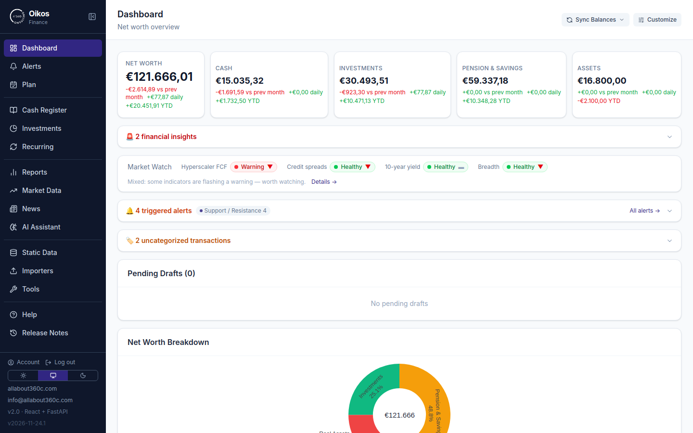
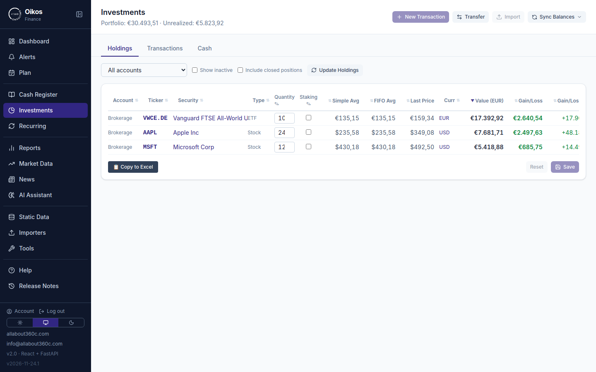
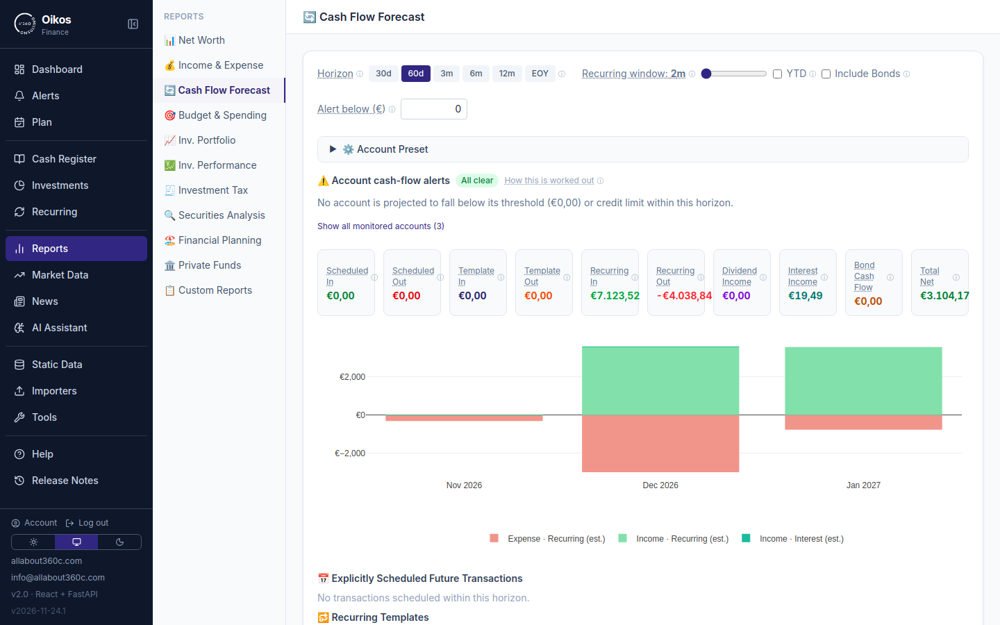
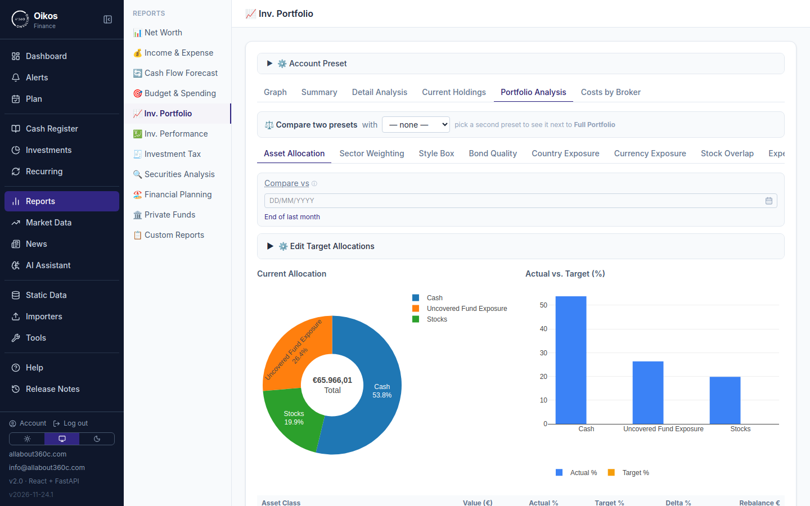

# Oikos

*A development of [ALL ABOUT 360 CONSULTING](https://github.com/atsob).*

A self-hosted personal finance app for one household: bank and cash accounts,
credit cards, loans, pensions, property and multi-currency investments (stocks,
ETFs, funds, bonds, crypto, options, CFDs) in one place, with bank imports and
reconciliation, cash-flow forecasting, budgeting, portfolio analysis, tax
reporting and an AI assistant that answers questions about your own data.
FastAPI + React/TypeScript, backed by PostgreSQL.

Your data stays in your own database: no subscription, no third-party
aggregator holding your bank login. Every account and security keeps its own
currency, and reports convert through historical FX rates into the reporting
currency you choose.

For the full walkthrough (PostgreSQL setup, the TLS certificate step, every
`.env` variable, backups, troubleshooting), see [INSTALL.md](./INSTALL.md).
This page is the fast path.

## Features

**Everyday money**
- **Dashboard** you can arrange: net worth, cash, investments, pension and
  savings, and assets, with daily, monthly and year-to-date changes; insights,
  alerts, upcoming bills, unusual transactions, pending drafts and the net
  worth trend.
- **Cash Register**: a ledger per account with splits, transfers (also across
  currencies), scheduled and future-dated entries, cleared/reconciled status,
  and the bank's own balance shown next to Oikos's. Credit cards show
  available credit and credit used.
- **Recurring templates** for rent, subscriptions, salary and loan instalments,
  feeding the forecast and the upcoming bills.
- **Plan**: a dated to-do list for money moves (rebalancing, tax-year steps),
  with a daily Telegram reminder.

**Importing**
- **Import & Reconcile**: load a CSV or Excel statement, or fetch the
  transactions straight from the bank. Rows are matched against what is
  already in Oikos, near-duplicates are flagged, new ones are imported with
  payee rules, and everything is marked reconciled.
- **Open banking (PSD2)** through [Enable Banking](https://enablebanking.com):
  balances and booked transactions from most European banks.
- **Brokers and exchanges**: Interactive Brokers (Flex), Saxo Bank, Revolut
  (Personal, Savings, Trading), Coinbase, Crypto.com, Capital.com, FXPro.
- **QIF** import from Quicken and similar apps.

**Investments**
- Holdings, cost basis (FIFO, LIFO, WAC, including short positions), realized
  and unrealized P&L, dividends, corporate actions, bonds with coupons and
  maturities, and margin products (FX spot, CFDs) booked the way the broker
  books them.
- **Performance**: P&L over any period, TWR/MWR, benchmarks against indexes or
  other accounts, best and worst days, dividend tracker, bond schedule.
- **Portfolio X-Ray**: look-through asset allocation against targets, sector
  weighting, Morningstar style box, bond quality, stock overlap between funds,
  expense ratios and currency exposure.
- **Signals and alerts**: price alerts, golden/death cross, trailing stops
  scaled to each security's volatility, 52-week-high drops, bond and dividend
  dates.
- **Private funds** with commitments, capital calls, NAV, DPI/RVPI/TVPI and IRR.

**Reports and planning**
- Net worth history, income and expense by category with drill-down,
  budget vs actual, spending trends, savings rate.
- **Cash flow forecast** from scheduled entries, recurring templates and
  detected payment patterns.
- **Tax**: capital gains, dividend and interest income, tax-loss harvesting,
  with tax rules you configure per instrument type. Greek-resident rules are
  seeded, and others can be added.
- **Financial planning**: retirement planner with Monte Carlo projections,
  goals, FIRE calculator, loan amortization.
- **Custom reports** and account presets (one person, a company, a trust).

**Market data and news**
- Prices and FX from Yahoo Finance, TradingView, Morningstar, ECB and FRED,
  with scheduled downloads, a data-quality check, watchlists, CAPE ratios and
  market watch panels.
- A news feed filtered to the securities and institutions you hold.

**AI**
- **AI Assistant**: a chat that answers questions such as "Where did my money
  go last month?" or "Which holdings did worst this year?" using ready-made
  queries over your data, and can search the web. It runs on a local model
  through [Ollama](https://ollama.com) or on Anthropic's Claude.
- Weekly and monthly AI summaries on the Dashboard.
- A read-only [MCP](https://modelcontextprotocol.io) server
  (`mcp_server.py`) so Claude Desktop or Claude Code can query your Oikos
  over HTTPS.

**Running it**
- Users with roles: Admin, Limited (only the accounts mapped to them) and
  Read-only, enforced by the server.
- Sign-in lockout after repeated failures, HTTPS, and settings and filters
  stored on the server so they follow you across devices.
- Works on a phone and can be added to the home screen.
- Backup and restore, database maintenance tools and scheduled jobs from the
  Tools page.

## Screenshots

*(All figures below are from a seeded demo instance with made-up data, not a
real household's finances. The app has gained pages since they were taken.)*

| | |
|---|---|
|  |  |
| Dashboard — net worth breakdown and trend | Investments — holdings with live gain/loss |
|  |  |
| Cash Flow Forecast — projected balance over a chosen horizon | Portfolio X-Ray — look-through asset allocation vs. target |

## Prerequisites

- **PostgreSQL** (with the [pgvector](https://github.com/pgvector/pgvector)
  extension installed and available) — reachable from wherever the app
  containers run. Install it on the host yourself (see
  [INSTALL.md § PostgreSQL setup](./INSTALL.md#1-postgresql-setup)), or skip
  that and run `docker compose --profile full up -d --build` instead to let
  Compose containerize it for you.
- **Docker** + **Docker Compose**.
- A Linux host — `docker-compose.yml` uses `network_mode: host` throughout, so
  Postgres (and optionally [Ollama](https://ollama.com), if you use the
  Ollama-backed AI features — see [INSTALL.md §
  1b](./INSTALL.md#1b-ollama-setup-optional)) are assumed reachable at
  `localhost`. Docker Desktop on Mac/Windows doesn't support host networking
  the same way; see the comment at the top of `docker-compose.yml` for the
  bridge-network alternative if that's your setup.

## Quick start

```bash
git clone https://github.com/atsob/Oikos.git
cd Oikos
cp .env.example .env
# edit .env: at minimum set DB_PASSWORD (to your Postgres password) and
# ADMIN_USERNAME/ADMIN_PASSWORD (your first login — see below)
docker compose up -d --build
```

`docker-compose.yml` also expects a TLS certificate at `./ssl/{cert,key,rootCA}.pem`
that isn't generated automatically — see [INSTALL.md § Generate a TLS
certificate](./INSTALL.md#3-generate-a-tls-certificate) for the one-time
`openssl` commands before your first `up`.

The schema is created automatically on first startup — no manual `psql` step.
Point `docker compose up` at any empty Postgres database and it self-initializes,
seeded with generic starter data (currencies, well-known US stocks/ETFs, major
international institutions, a standard expense/income category list, common
payees, and Greek-resident tax rules) so Static Data isn't empty on day one.

Open `https://<host>:8443` and log in with the `ADMIN_USERNAME`/`ADMIN_PASSWORD`
from `.env` (only used once, to create that first account — safe to leave set
afterward). The self-signed cert's CA is downloadable from
`http://<host>:8444/ca.crt` if you want your browser/OS to trust it directly.
Add more accounts, or change your password, from the sidebar's **Account** panel
once logged in.

See `.env.example` for every other optional integration (market data, open
banking imports, local LLM) — all are optional and the app runs fine without
them; unset ones just show up empty or need entering manually in the relevant
import tab.

## Updating

```bash
git pull
docker compose up -d --build
```

Startup migrations (schema changes since your last update) run automatically
and are idempotent — safe to run on every restart.

## What's new

See [CHANGELOG.md](./CHANGELOG.md), also browsable in-app under **Release Notes**.

## Support

Oikos is free and open source. If it's useful to you, consider
[sponsoring its development on GitHub](https://github.com/sponsors/atsob) —
every bit helps keep it maintained.

## License

Copyright © 2026 All About 360 Consulting.

GNU AGPLv3 — see [LICENSE](./LICENSE). In short: you're free to self-host,
modify, and share Oikos under those terms, but if you run a modified version
as a network service for others, the AGPL requires you to make that
modified source available to those users too.

Want to use Oikos somewhere the AGPL's terms don't fit — embedding it in a
closed-source product, or offering it as a hosted service without the
source-disclosure obligation — a separate commercial license is available;
[open an issue](https://github.com/atsob/Oikos/issues) or contact the
maintainer directly.
